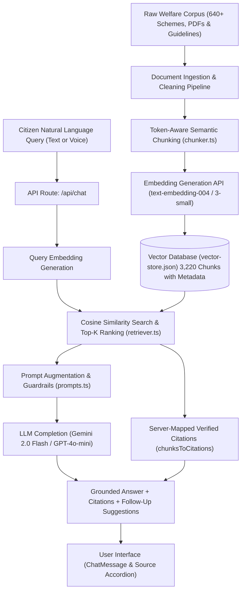

<div align="center">

# 🏛️ YojnaSetu (योजनासेतु)
### Public Information Portal & Grounded AI Welfare Scheme Assistant

[-black?style=for-the-badge&logo=next.js)](https://nextjs.org/)
[](https://www.typescriptlang.org/)
[](https://tailwindcss.com/)
[](https://aistudio.google.com/)
[](https://vitest.dev/)

*Translating complex government gazettes and welfare rules into plain, accessible, and citation-backed guidance for Indian citizens and helpdesk operators.*

</div>

---

## 📌 Problem Statement

State and Central Government departments publish welfare schemes, subsidy guidelines, scholarship rules, and application manuals across scattered PDFs, departmental portals, and gazette notifications. 

**The core challenges:**
1. **Scattered Information:** Citizens and Common Service Centre (CSC) helpdesks cannot easily determine which specific scheme applies to their demographic situation.
2. **Bureaucratic Ambiguity:** Eligibility criteria (income caps, land holding thresholds, caste categorizations, age brackets) are written in dense legal terminology.
3. **Middlemen Exploitation:** Lack of transparency regarding mandatory document checklists forces underprivileged citizens to pay unauthorized commission agents.
4. **AI Hallucination Risk:** Standard generic LLMs often hallucinate government rules, subsidy amounts, or application deadlines, creating legal and financial hazards for beneficiaries.

---

## 💡 What is YojnaSetu & What Does It Solve?

**YojnaSetu** is an end-to-end, trustworthy public information web platform and conversational AI assistant indexing **640+ verified Indian welfare schemes** across Union Ministries and State Governments.

### How YojnaSetu Solves the Problem:
- **🔍 Semantic RAG Scheme Assistant (YojnaAi):** Citizens ask questions in natural English or Hindi (e.g. *"What scheme exists for intercaste marriage?"* or *"पीएम किसान योजना की पात्रता क्या है?"*). The system retrieves top-$k$ relevant chunks from official guidelines and generates an accurate, grounded answer.
- **📄 Server-Mapped Source Citations:** Every single answer is paired with collapsible citation accordions detailing the official document title, department, page number, and direct link to the government PDF. The AI is prevented from fabricating URLs.
- **⚖️ Deterministic Eligibility Engine:** A 100% auditable, rule-based questionnaire evaluating demographic profiles (State, Category, Age, Gender, Income, Occupation, Disability) against codified government rules. It explains exactly *why* a citizen is eligible or *which* specific requirement is missing.
- **🗣️ Bilingual & Voice Enabled:** Native support for English and Hindi, along with one-click speech-to-text input via the Web Speech API for rural and semi-literate accessibility.
- **🗂️ ChatGPT-Style Conversation Management:** Clean left side panel with conversation history stored in local storage, allowing users to switch between previous inquiries or start fresh sessions.

---

## 🛠️ Tech Stack & Architecture Choices

| Technology | Role in Project | Why This Was Chosen |
| :--- | :--- | :--- |
| **Next.js 16 (App Router)** | Full-Stack Web Framework | Provides React Server Components (RSC) for fast initial load and SEO, server-side API Routes (`/api/chat`, `/api/eligibility`, `/api/admin/reindex`), streaming response capabilities, and zero-bundle overhead for static scheme listings. |
| **TypeScript** | Strict Typing & Integrity | Enforces strict end-to-end type safety across scheme models, eligibility conditions, vector embeddings, chunk metadata, and chat states. Eliminates runtime crashes in document parsing. |
| **Tailwind CSS 4** | Styling & Design System | High-performance, zero-runtime utility styling engine with custom design tokens. Provides an accessible, responsive light-mode interface compliant with WCAG 2.2 AA standards from 320px mobile viewports to desktop. |
| **Vector Store & Embeddings** | Semantic Retrieval Engine | Uses vector embeddings (`text-embedding-004` / `text-embedding-3-small`) stored with metadata in a local vector store. Implements cosine similarity search with top-$k$ retrieval and score thresholds, ensuring low latency (<50ms) without mandatory cloud database vendor lock-in. |
| **AI Provider Abstraction** | Model Orchestration | Decoupled adapter layer supporting **Google Gemini (Gemini 2.0 Flash)** and **OpenAI (GPT-4o-mini)**. Designed with fallback logic that displays retrieved document chunks even if AI API keys are unavailable. |
| **React-Markdown & Remark-GFM** | Output Rendering | Parses assistant responses into structured Markdown: high-contrast bold typography, nested checklists, data tables, and safe links without XSS vulnerabilities. |
| **Zod & React Hook Form** | Input Validation | Type-safe schema validation for user queries, demographic forms, and admin document re-indexing requests. |
| **Lucide React** | Accessible Iconography | Lightweight, consistent iconography (plus custom SVG Ashoka Dharma Chakra branding). |
| **Web Speech API** | Voice Input | Native browser-level speech recognition enabling vernacular voice queries without third-party speech API costs. |
| **Vitest** | Automated Test Suite | Lightning-fast test runner executing 40+ unit and integration tests across eligibility logic, RAG retrieval, chunking, and API endpoints in <1 second. |

---

## 📐 End-to-End RAG Pipeline Architecture



### Key Safety & Guardrail Mechanisms:
1. **Server-Mapped Citations:** The LLM does not generate citation links. Citations are extracted directly on the server from the retrieved vector chunks that scored above the similarity threshold.
2. **Refusal Handling:** If a question cannot be answered from the indexed official documents, the system refuses to guess and directs the user to the relevant department portal.
3. **Deterministic Separation:** Eligibility calculation is completely separated from the generative LLM. Math and rules (e.g. *Income < ₹2,50,000*, *Age between 18–35*) are computed deterministically in pure TypeScript.

---

## ⚖️ How YojnaSetu Differs from myScheme

| Feature | Official myScheme / State Portals | YojnaSetu |
| :--- | :--- | :--- |
| **Search Mechanism** | Keyword & static drop-down filters | **Semantic Vector RAG** understanding contextual queries |
| **Question Answering** | Static PDF downloads only | **Grounded conversational answers** with exact page citations |
| **Eligibility Assessment** | Hard filter forms with vague rejections | **Transparent rule engine** showing step-by-step why you qualify |
| **Document Citations** | None (user must read 50-page PDFs) | **Direct page & paragraph-level quotes** linking to original gazettes |
| **Voice Querying** | Rare or unavailable | **Built-in Speech-to-Text** in English & Hindi |
| **Chat History** | Not available | **Client-side session persistence** with ChatGPT-style sidebar |

---

## 📂 Repository Structure

```
├── data/
│   ├── raw-myscheme.json          # Raw corpus of 600+ scraped Indian schemes
│   ├── custom-schemes.json        # Curated Central & State scheme definitions
│   └── vector-store.json          # Pre-computed vector embeddings (3,220 chunks)
├── src/
│   ├── app/
│   │   ├── api/
│   │   │   ├── admin/reindex/     # POST /api/admin/reindex — batch re-vectorization
│   │   │   ├── chat/              # POST /api/chat — RAG Q&A service
│   │   │   ├── eligibility/       # POST /api/eligibility/evaluate — rule evaluation
│   │   │   └── schemes/           # GET /api/schemes, GET /api/schemes/[slug]
│   │   ├── ask/                   # AI Assistant chat view with ChatGPT-style sidebar
│   │   ├── eligibility/           # Multi-step eligibility questionnaire
│   │   ├── schemes/               # Searchable catalog & scheme detail views
│   │   └── about/                 # "How It Works" system architecture documentation
│   ├── components/
│   │   ├── chat/                  # ChatMessage, ChatComposer, ChatSidebar, SourceCitationCard
│   │   ├── eligibility/           # Questionnaire form controls & results view
│   │   ├── home/                  # Hero, quick search, category cards, FAQ accordion
│   │   ├── schemes/               # Scheme cards, filter controls, badge chips
│   │   └── ui/                    # Accessible buttons, badges, modals, input primitives
│   └── lib/
│       ├── ai/                    # Gemini & OpenAI provider adapters
│       ├── data/                  # Sample schemes & custom scheme loaders
│       ├── eligibility/           # Deterministic rule evaluation engine
│       ├── ingestion/             # Document chunker & batch vector ingest pipeline
│       ├── rag/                   # Retriever, system prompts, citation mapper
│       ├── types/                 # TypeScript interfaces (Scheme, Chunk, Citation, etc.)
│       └── vectorstore/           # Cosine similarity vector store engine
```

---

## 🚀 Getting Started

### Prerequisites
- **Node.js**: v18.18.0 or higher
- **npm**: v9.0.0 or higher

### 1. Installation

```bash
# Clone the repository
git clone https://github.com/alok1047/YojnaSetu.git
cd YojnaSetu

# Install dependencies
npm install
```

### 2. Environment Configuration

Create a `.env.local` file in the root directory:

```env
# AI Provider Selection: 'gemini' (recommended) or 'openai'
AI_PROVIDER=gemini

# Google Gemini Configuration
GEMINI_API_KEY=your-gemini-api-key-here
GEMINI_MODEL=gemini-2.0-flash
GEMINI_EMBEDDING_MODEL=text-embedding-004

# (Optional) OpenAI Configuration
# OPENAI_API_KEY=your-openai-api-key-here
# OPENAI_MODEL=gpt-4o-mini
# OPENAI_EMBEDDING_MODEL=text-embedding-3-small

# Admin Key for Ingestion & Re-indexing
ADMIN_SECRET=admin123
```

> **Note:** If no AI key is provided, the application continues to run in offline/fallback mode. The Eligibility Engine and Scheme Directory work completely without an AI API key.

### 3. Run Development Server

```bash
npm run dev
```

Open [http://localhost:3000](http://localhost:3000) in your browser.

---

## 🧪 Testing & Verification

The project includes an automated test suite verifying all core algorithms:

```bash
# Run unit and integration tests
npm test

# Run TypeScript type check
npx tsc --noEmit

# Run ESLint
npm run lint
```

**Test Coverage Highlights:**
- **Deterministic Eligibility:** Tests passing, failing, and partial criteria evaluation.
- **RAG Retrieval:** Tests top-$k$ similarity chunk ranking and threshold filtering.
- **Answer Generation:** Tests fallback behavior when AI provider is offline.
- **Data Validation:** Tests Zod schema boundary conditions for demographic inputs.

---

## 📖 Available Scripts

| Command | Description |
| :--- | :--- |
| `npm run dev` | Starts the Next.js local development server with Hot Module Replacement (HMR) |
| `npm run build` | Compiles optimized production build |
| `npm start` | Runs the compiled production application |
| `npm test` | Runs the Vitest test runner across all 6 test suites |
| `npm run lint` | Runs Next.js ESLint checks |

---

## 🛡️ License & Ethical Disclaimer

**Educational & Technological Demonstration:**
YojnaSetu is developed as an educational demonstrator and public service technology project. While all scheme information and citations are sourced from official government publications and guidelines, citizens must verify all rules with the respective administrative departments before submitting legal applications.

Distributed under the MIT License.
